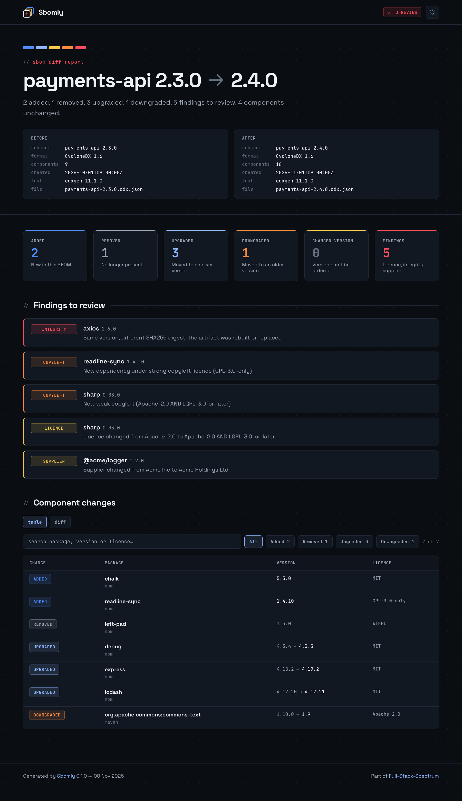
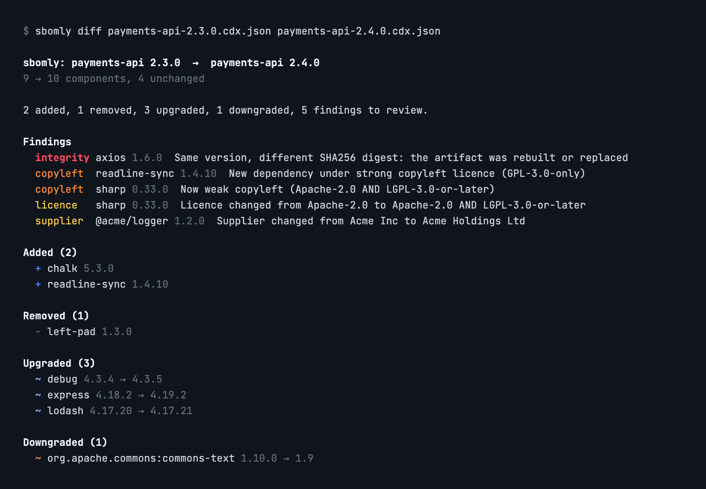
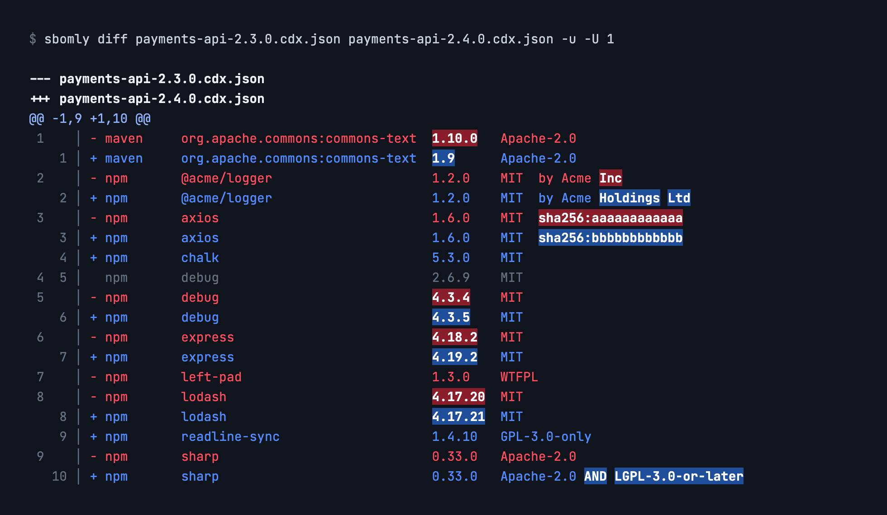
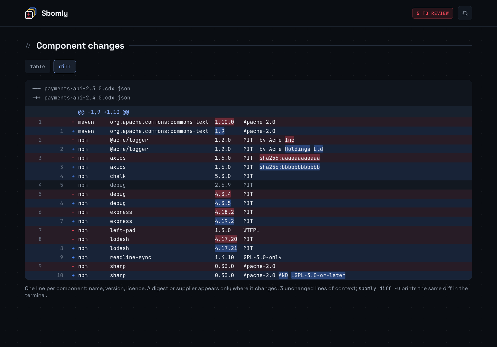

[](https://github.com/fullstackspectrum/sbomly)

[](https://github.com/fullstackspectrum/sbomly/actions/workflows/build.yml)
[](https://pypi.org/project/sbomly/)
[](https://pypi.org/project/sbomly/)
[](https://github.com/fullstackspectrum/homebrew-sbomly)
[](https://hub.docker.com/r/fullstackspectrum/sbomly)
[](https://github.com/fullstackspectrum/sbomly/blob/main/LICENSE)

[](https://pepy.tech/projects/sbomly)
[](https://hub.docker.com/r/fullstackspectrum/sbomly)

# Sbomly

**See what changed between two SBOMs, and what deserves a closer look.**

Sbomly compares two SBOMs, CycloneDX or SPDX JSON, and tells you which components were added, removed, upgraded or downgraded. It also flags the changes a reviewer should actually stop for:

- **Integrity:** same version, different digest. The artifact was rebuilt or replaced.
- **Copyleft:** a new dependency, or a new licence, that brings in GPL, LGPL, AGPL and similar.
- **Licence:** a licence changed, or stopped being declared.
- **Supplier:** a package's supplier changed. In a language ecosystem that's the account-takeover pattern.

Output goes wherever you need it: a terminal summary, a Markdown summary sized for a PR comment, JSON for other tools, and a self-contained HTML report that works offline. `--fail-on` turns any category into a CI gate.

Sbomly has no runtime dependencies and needs Python 3.10 or later.

> Sbomly is a sibling of [Vulnly](https://github.com/fullstackspectrum/Vulnly) and part of [Full-Stack-Spectrum](https://fullstackspectrum.com/): small open-source tools that turn noisy supply chain data into decisions.



## Install

```bash
pipx install sbomly     # or: pip install sbomly
brew install fullstackspectrum/sbomly/sbomly
```

Or run the container image, mounting the directory that holds your SBOMs:

```bash
docker run --rm -t -v "$PWD:/data" fullstackspectrum/sbomly diff old.json new.json
```

## Usage

```bash
sbomly diff old.cdx.json new.cdx.json
```

Findings come first, most serious at the top, then each kind of component change:



Write reports alongside the terminal summary:

```bash
sbomly diff old.json new.json --html report.html --markdown pr.md --json diff.json
```

The HTML report, shown at the top of this page, is a single file with its fonts embedded, so it opens offline and can be attached to a CI run or a ticket. Search and the change-type filters work without a network connection, and `--theme light` gives a light version for printing.

### Diff view

Prefer to read changes the way you read code? `-u` prints a unified diff of the two component lists, like `diff -u`, with one line per component sorted like a lockfile:

```bash
sbomly diff old.json new.json -u        # 3 lines of context
sbomly diff old.json new.json -u -U 0   # changes only
```



In a colour terminal, the diff gets an old/new line-number gutter and highlights the words that changed in each `-`/`+` pair. When piped, or with `--no-color`, it's a plain unified diff that `patch` and other diff tools accept.

Each line shows the name, version and licence. A digest or supplier is added only where it changed, so a same-version finding still shows up as a `-`/`+` pair. Lines come from Sbomly's own comparison rather than the raw files, so anything it treats as equivalent, like licence term order or a new distro qualifier, stays as context instead of showing up as noise. The output is a valid patch.

The HTML report has the same diff behind a `table` / `diff` toggle, with line numbers and the changed words highlighted. Add `#diff` to the report's URL to open it on the diff view. With `-u`, the Markdown output also gets a ```` ```diff ```` block, which GitHub colours in PR comments.



*Screenshots show sample data from `tests/fixtures`. To regenerate them, run `python docs/screenshots/src/render.py`.*

Read one SBOM from stdin, for example straight from a generator:

```bash
syft my-image:latest -o cyclonedx-json | sbomly diff baseline.cdx.json -
```

### Options

| Option | |
|---|---|
| `-f, --format text\|markdown\|json` | What to print to stdout (default `text`) |
| `--html FILE` | Write the offline HTML report |
| `--markdown FILE` | Write the Markdown summary |
| `--json FILE` | Write the full diff as JSON |
| `--fail-on LIST` | Exit 1 if any of these categories occur (see below) |
| `-u, --unified` | Print a unified diff of the component lists instead of the summary, and add it to Markdown output |
| `-U, --context N` | Unchanged components shown around each change in the diff (default 3) |
| `--title TEXT` | Title for the HTML and Markdown reports |
| `--theme dark\|light` | HTML report theme (default `dark`) |
| `--limit N` | Rows per section in text and Markdown (default 100) |
| `--no-color` | Plain terminal output. `NO_COLOR` and `FORCE_COLOR` are respected |
| `-q, --quiet` | Print nothing to stdout |

### Gating CI with `--fail-on`

| Category | Fails when |
|---|---|
| `added` / `removed` | A component appears or disappears |
| `upgraded` / `downgraded` | A component moves to a newer or older version |
| `changed` | A version changes but can't be ordered (commit SHAs, digests) |
| `hash` | Same version, different digest |
| `copyleft` | A new dependency is copyleft, or a licence becomes more restrictive |
| `license` | A licence changes, or is no longer declared |
| `supplier` | A component's supplier changes |
| `any` | Any of the above |

```bash
sbomly diff main.cdx.json pr.cdx.json --fail-on hash,copyleft,downgraded
```

Exit codes: `0` passed, `1` a `--fail-on` category was hit, `2` bad usage or an unreadable SBOM.

Some findings are informational. They're shown, but they never fail a build:

- A licence that was unknown and is now declared.
- A same-version digest change where the purl's `distro` qualifier also changed. Distros rebuild unchanged packages for each release.
- A supplier change for an OS package (apk, deb, rpm). There, the supplier is the distro maintainer, and maintainers rotate.

## GitHub Actions

Sbomly ships as a composite action. It writes the Markdown summary to the job page, and exposes the report paths for a PR comment or artifact upload.

```yaml
- uses: fullstackspectrum/sbomly@v0.1.0
  with:
    old: sbom-main.cdx.json
    new: sbom-pr.cdx.json
    fail-on: hash,copyleft
```

Or call the CLI yourself on any CI system:

```bash
pipx run sbomly diff baseline.json current.json --markdown sbomly.md --fail-on hash
```

## How components are matched

Components are paired across the two SBOMs by package URL, ignoring the version. Qualifiers that only describe the build environment, like `distro` and `repository_url`, are also ignored, so moving to a new base image doesn't report every OS package as removed and re-added. `arch`, `classifier` and `type` are kept, because they identify a different artifact. PyPI names are normalised as PEP 503 describes. Components without a purl fall back to their group and name.

When a package has several versions in both SBOMs, which npm often does, the leftover versions are paired in version order.

## Supported formats

| Format | Versions |
|---|---|
| CycloneDX JSON | 1.4 to 1.6 tested, older versions usually work |
| SPDX JSON | 2.2, 2.3 |

CycloneDX XML, SPDX tag-value and SPDX 3.0 aren't supported yet. Sbomly tells you so rather than guessing.

## Development

```bash
python -m venv .venv && . .venv/bin/activate
pip install -e ".[dev]"
pytest
```

## Licence

Apache-2.0. The bundled Space Grotesk and JetBrains Mono fonts are under the SIL Open Font License 1.1. See `sbomly/assets/`.

Copyleft classification is a triage signal, not legal advice.
