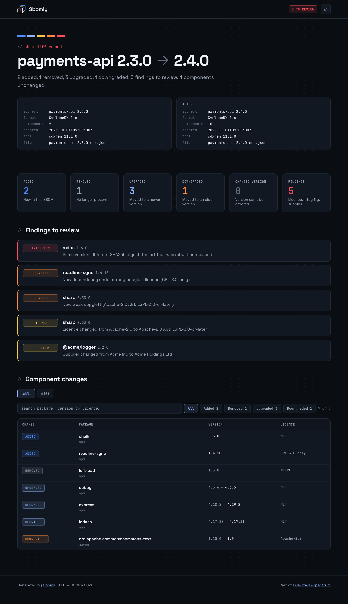

# Sbomly

See what changed between two SBOMs, and what deserves a closer look. This is the official container image for [Sbomly](https://github.com/fullstackspectrum/sbomly).

Sbomly compares two SBOMs, CycloneDX or SPDX JSON, and reports which components were added, removed, upgraded or downgraded. It also flags integrity (same version, new digest), copyleft, licence and supplier changes, and `--fail-on` turns any of them into a CI gate.



## Quick start

Mount the directory holding your SBOMs at `/data` and diff them:

```sh
docker run --rm -t -v "$PWD:/data" fullstackspectrum/sbomly diff old.cdx.json new.cdx.json
```

Reports are written relative to `/data`, so they land next to your SBOMs:

```sh
docker run --rm -t -v "$PWD:/data" fullstackspectrum/sbomly diff old.json new.json --html report.html --markdown pr.md
```

Read one SBOM from stdin with `-i`:

```sh
syft my-image:latest -o cyclonedx-json | docker run --rm -i -v "$PWD:/data" fullstackspectrum/sbomly diff baseline.cdx.json -
```

The `-t` flag gives you colour in the terminal. Drop it in CI logs.

## Tags

| Tag | Points to |
| --- | --- |
| `latest` | The newest stable release |
| `X.Y` (e.g. `0.1`) | The newest patch release in that minor series |
| `X.Y.Z` (e.g. `0.1.0`) | One exact release |

Every tag is built for `linux/amd64` and `linux/arm64`. Pre-releases are published under their exact version only and never move `latest`.

## Gating CI

```sh
docker run --rm -v "$PWD:/data" fullstackspectrum/sbomly diff main.cdx.json pr.cdx.json --fail-on hash,copyleft,downgraded
```

Exit codes: `0` passed, `1` a `--fail-on` category was hit, `2` bad usage or an unreadable SBOM. See the [full option list](https://github.com/fullstackspectrum/sbomly#options).

## Permissions

The container runs as the non-root UID 65532. If that UID can't write reports to a bind-mounted directory (common on Linux), add `--user "$(id -u):$(id -g)"`.

## Hardened base

The image is built on the Alpine variant of [Docker Hardened Images](https://dhi.io) for Python. The runtime has no shell or package manager, and Sbomly (which has no runtime dependencies) runs from its own virtualenv. It's rebuilt on each release to pick up base image patches.

## Other ways to install

```sh
brew install fullstackspectrum/sbomly/sbomly
pipx install sbomly
```

## Links

- Source and full documentation: [github.com/fullstackspectrum/sbomly](https://github.com/fullstackspectrum/sbomly)
- Issues: [github.com/fullstackspectrum/sbomly/issues](https://github.com/fullstackspectrum/sbomly/issues)
- PyPI: [sbomly](https://pypi.org/project/sbomly/)
- License: Apache-2.0
